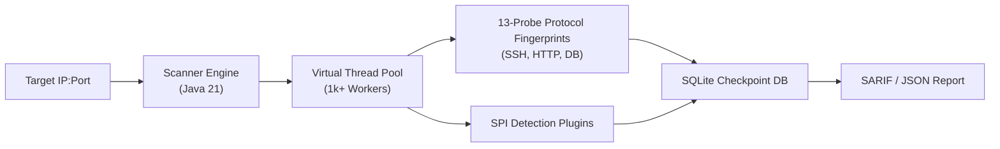
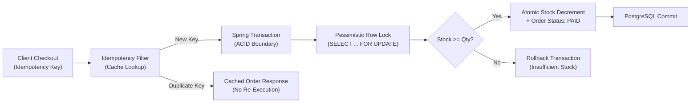
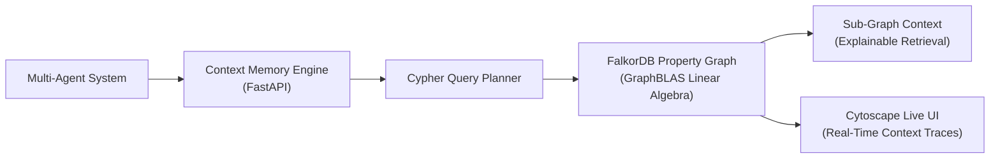

# Himanshu Jha

```text
╭─ himanshu@arch:~$ ./whoami.sh ───────────────────────────────────────────────╮
│  Focus:     Runtime Internals • Concurrency • Distributed Infrastructure     │
│  Upstream:  Node.js • Apache Pulsar • Palo Alto Networks • Redisson          │
│  Contact:   07himanshuraj@gmail.com • linkedin.com/in/himanshu-jha-728834337 │
╰──────────────────────────────────────────────────────────────────────────────╯
```

### Upstream & Open Source

- **[Node.js](https://github.com/nodejs/node)** — Implemented ECMAScript Explicit Resource Management (`Symbol.dispose` / `Symbol.asyncDispose`) for synchronous, callback, promise, and virtual file system (VFS) implementations of `fs.mkstemp` ([#67419](https://github.com/nodejs/node/pull/67419)).
- **[Apache Pulsar](https://github.com/apache/pulsar)** — Resolved distributed test concurrency races in `TableView` message dispatching under high-load parallel execution ([#27509](https://github.com/apache/pulsar/pull/27509) · *Merged*).
- **[Palo Alto Networks / Checkov](https://github.com/bridgecrewio/checkov)** — Mitigated CVE-2024-23342 (P-256 timing attack) by migrating external check verification to `cryptography` hazmat primitives with backward-compatible DER parsing ([#7822](https://github.com/bridgecrewio/checkov/pull/7822)).
- **[Redisson](https://github.com/redisson/redisson)** — Fixed a memory leak in Redis distributed local-cached map key eviction during transactional commits and key invalidation in `LocalCacheListener` ([#7424](https://github.com/redisson/redisson/pull/7424)).
- **[Checkstyle](https://github.com/checkstyle/checkstyle)** — Resolved AST traversal `ClassCastException` on pattern-matching switch expressions in `AvoidInlineConditionalsCheck` ([#22493](https://github.com/checkstyle/checkstyle/pull/22493)).

---

### Systems Built

#### [VulnScan](https://github.com/HimanshuJha-2005/vulnscan) — Multithreaded Network Scanner
High-throughput vulnerability scanner in Java 21 utilizing virtual threads for concurrent protocol probing without operating system thread exhaustion. Features SQLite checkpoint resume, SPI plugin engine, and SARIF output.



#### [ForgeCommerce](https://github.com/HimanshuJha-2005/ForgeCommerce) — Transactional Commerce Engine
Spring Boot and PostgreSQL backend enforcing client idempotency keys, single-transaction pessimistic row locking (`SELECT ... FOR UPDATE`) to prevent inventory overselling, and deterministic order state transitions.



#### [Continuum](https://github.com/HimanshuJha-2005/continuum) — Cross-Agent Graph Memory
Graph-anchored context engine built for WeMakeDevs × FalkorDB Graph Hacks. Anchors multi-agent context to a shared FalkorDB property graph with live Cypher execution traces and graph exploration UI.



---

### Active Investigations

- **Runtime Semantics:** Profiling TC39 Explicit Resource Management lifecycle in Node.js VFS vs POSIX handles.
- **Virtual Thread Scalability:** Benchmarking Java 21 carrier thread pinning under high-concurrency socket I/O.
- **Distributed State:** Analyzing transactional key eviction and consensus edge cases in distributed key-value stores.

---

### Stack

- **Languages:** Java 21, Python, C++, JavaScript / TypeScript, SQL, Bash
- **Runtimes & Frameworks:** Spring Boot, Node.js, FastAPI, Express
- **Storage & Infrastructure:** PostgreSQL, Redis, FalkorDB, SQLite, Docker, Linux
